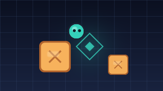

# 推箱子 TV (Sokoban for Android TV)

用电视遥控器玩的经典推箱子，纯 Android 框架实现（无第三方依赖），APK 只有 ~50 KB。



## 遥控器操作

| 按键 | 作用 |
| --- | --- |
| 方向键 ↑↓←→ | 走动 / 推箱子（按住可连续移动） |
| OK / 确认键 | 打开菜单（继续 · 撤销一步 · 重新开始 · 返回关卡列表） |
| BACK | 返回关卡列表 |
| `Z` / `R`（外接键盘） | 撤销 / 重开 |
| 手机触屏 | 滑动移动，点按打开菜单 |

关卡列表用方向键选择，OK 进入；未通关的关卡显示「最少 N 推」，通关后显示「★ 步数」。
关卡不限锁，随便玩。进度和最好成绩保存在 SharedPreferences 里。

## 构建

环境要求：**JDK 17+**、Android SDK（platform 35 + build-tools 35）。

```bash
# 方式一：Android Studio 打开项目根目录，等 Sync 完成后点 Run

# 方式二：命令行
./gradlew assembleDebug
adb install -r app/build/outputs/apk/debug/app-debug.apk
```

### 刚 clone 下来需要做的唯一一件事：告诉它 SDK 在哪

`local.properties` 是**机器相关**的文件，故意不提交到仓库（里面是绝对路径）。
所以 clone 后它并不存在，构建会报：

```
SDK location not found. Define a valid SDK location with an ANDROID_HOME
environment variable or by setting the sdk.dir path in your project's
local properties file at .../local.properties
```

三种解决办法，任选其一：

1. 用 **Android Studio** 打开项目 —— 它会自动生成 `local.properties`；
2. 设环境变量：`export ANDROID_HOME=/path/to/Android/Sdk`（Windows：`set ANDROID_HOME=D:\Sdk`）；
3. 自己在项目根目录新建 `local.properties`，写一行：
   ```properties
   sdk.dir=D\:\\Sdk
   ```
   （Windows 路径里的 `:` 和 `\` 都要转义；Linux/macOS 写 `sdk.dir=/home/me/Android/Sdk` 即可）

其余说明：

- 编译 SDK 35 / targetSdk 35 / minSdk 21，Java 17，无 AndroidX、无第三方依赖。
- **不需要 Python。** `tools/` 只是生成/校验关卡和画图用的离线脚本，
  不参与构建；删掉整个 `tools/` 目录也能正常编译。产物（`levels.txt`、两张 png）已经在仓库里了。
- **首次构建需要联网**（下载 Gradle 8.11.1 发行版与 AGP 依赖），之后可离线。
- 清单里带 `LEANBACK_LAUNCHER` 入口、`android:banner`（320×180），并声明
  `touchscreen`/`leanback` 为可选，所以同一个 APK 也能装到手机上调试。
- 连 GitHub 不稳的网络下，可先 `git config --global http.version HTTP/1.1` 再 clone/push。

## 关卡

`app/src/main/assets/levels.txt` 是标准 XSB 文本，`;` 开头的行是注释：

```
; 7. 第 7 关 | 7x7 | par 7
#######
# .$+ #
#  $$ #
#  #  #
#   . #
#######
```

- `#` 墙、`.` 目标点、`$` 箱子、`*` 箱子已在目标点、`@` 玩家、`+` 玩家站在目标点。
- 注释里的 `par N` 会作为「最少 N 推」显示；没有也行，只是不显示最优值。
- 想换关卡集：把任意 XSB/`.sok` 文本粘贴进去即可，解析器会自动判断房间外区域。
- 关卡之间的空行可有可无。

当前内置 **31 关**，难度从 1 推递增到 15 推。

### 关卡是怎么来的

本来想直接抄一个开源关卡集（Microban 等），但这台机器访问 `raw.githubusercontent.com`
被拦截，拿不到现成文件。所以改成**程序生成 + 求解器验证**，保证每一关都可解：

```bash
cd tools
python gen_levels.py --out ../app/src/main/assets/levels.txt   # 生成（约 4 分钟）
python verify_levels.py ../app/src/main/assets/levels.txt      # 复查结构 + 可解性
python make_art.py                                             # 重新生成横幅和图标
```

- `gen_levels.py`：从「全部箱子已在目标点」的终局出发做**反向拉扯**，倒推得到的局面天生有解；
  再用推动数 BFS 求最优步数，按难度分档挑选。同一局面经过镜像/旋转去重。
- `verify_levels.py`：按 App 的解析规则重新读一遍关卡文件，逐关求解并核对结构
  （箱子数=目标点数、只有一行玩家、行宽一致）。
- `make_art.py`：纯 Python（zlib + 距离场抗锯齿）画出 TV banner 和启动图标，不依赖 PIL。

### Java 侧自测

`tools/JavaSelfTest.java` 直接调用 App 里真实的 `Level` 解析器和 `GameEngine`：
逐关搜索最优解 → 用 `GameEngine` 回放 → 断言 `isSolved()` → 一路撤销回到开局并核对计数。

```bash
javac -encoding UTF-8 -d tools/out \
  app/src/main/java/com/sokbantv/game/Level.java \
  app/src/main/java/com/sokbantv/game/GameEngine.java \
  tools/JavaSelfTest.java
java -cp tools/out JavaSelfTest app/src/main/assets/levels.txt
```

## 代码结构

```
app/src/main/java/com/sokbantv/game/
  Level.java           关卡模型 + XSB 解析（含房间外区域识别）
  LevelRepository.java 一次性读取 assets/levels.txt
  GameEngine.java      走/推、计数、撤销栈、卡死判断
  BoardView.java       Canvas 绘制（墙体/目标点/木箱/小人），平滑动画，滑动输入
  MainActivity.java    关卡选择（遥控器焦点网格 + 成绩）
  GameActivity.java    游戏界面、菜单、结算弹窗
  Progress.java        最好成绩持久化
  Ui.java              深色 TV 风格控件与焦点高亮
```

## 已做的验证

在 1080p Android TV 模拟器（API 30，`tv_1080p`）上实测：

- 启动无崩溃，关卡网格 6 列自适应 1920×1080，可滚动到最后一行
- 方向键移动/推动，HUD 实时更新「步数 · 推动 · 最少 N 推」
- OK 菜单、撤销、重新开始、返回列表均正常
- 第 1 关推一步后弹出「过关！」结算，可按「下一关」继续
- 关卡列表显示「已通关 1 / 31」和「★ 1 步」
- 把箱子推进角落时出现「有箱子已经卡死在角落」提示
- 快速连按方向键无异常
